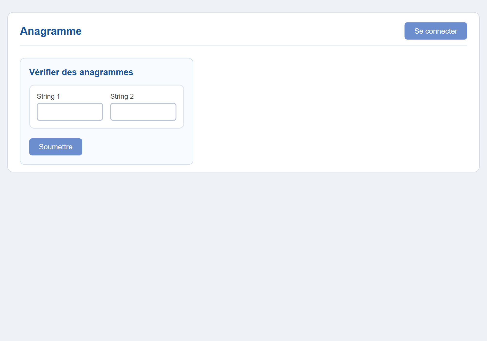
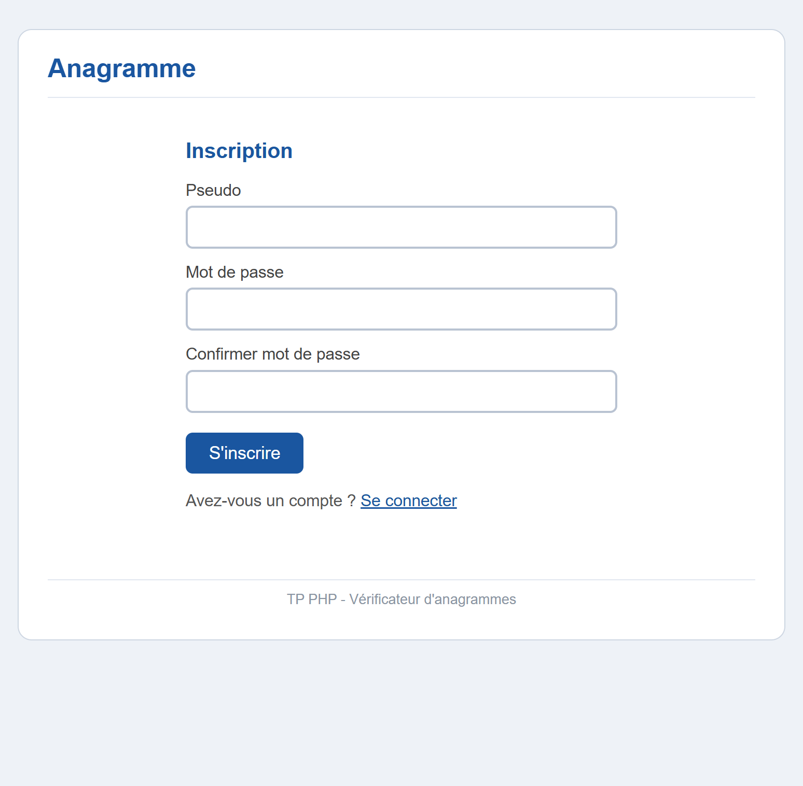
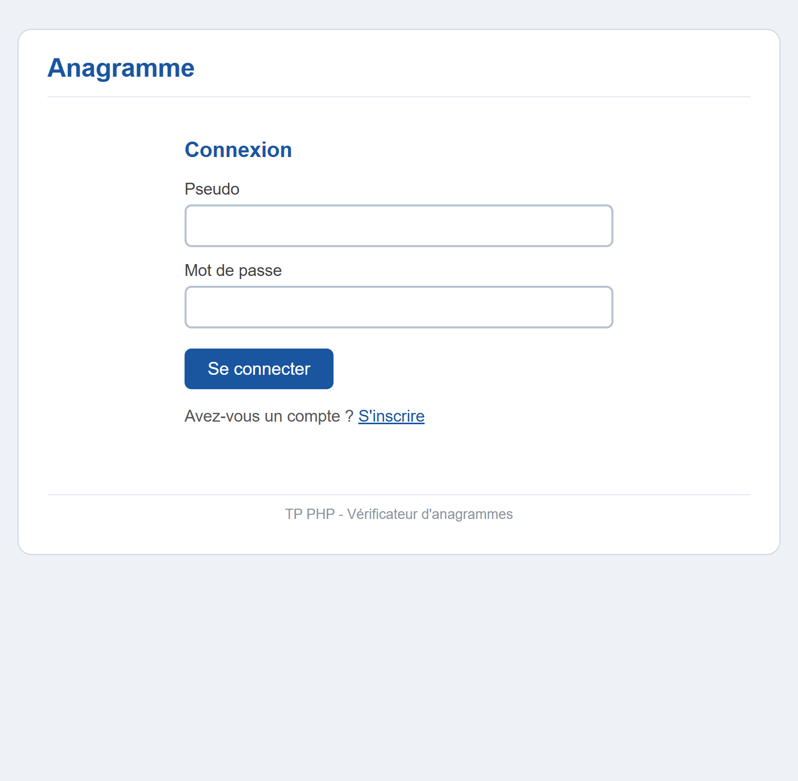
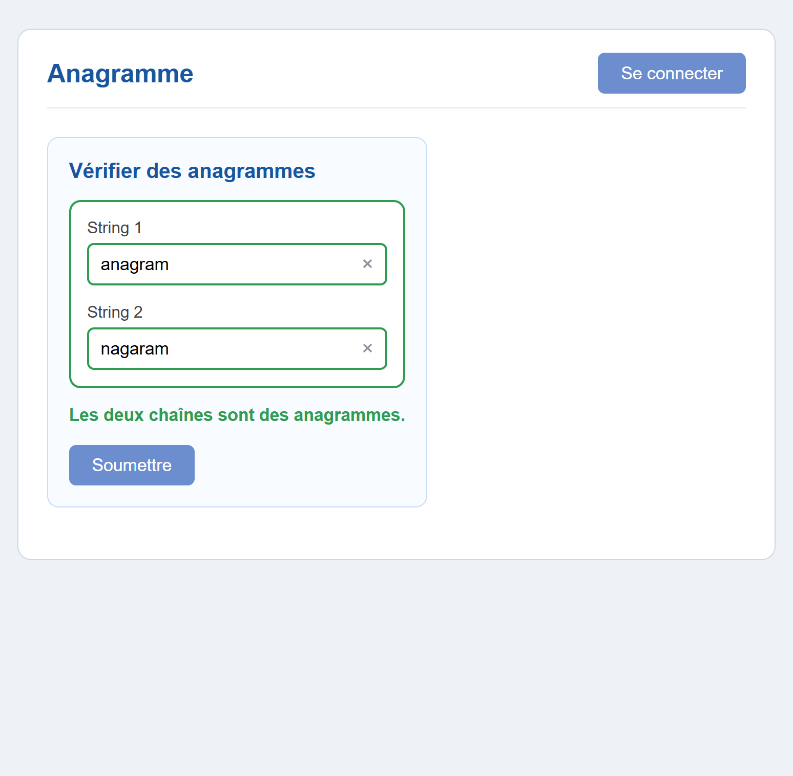
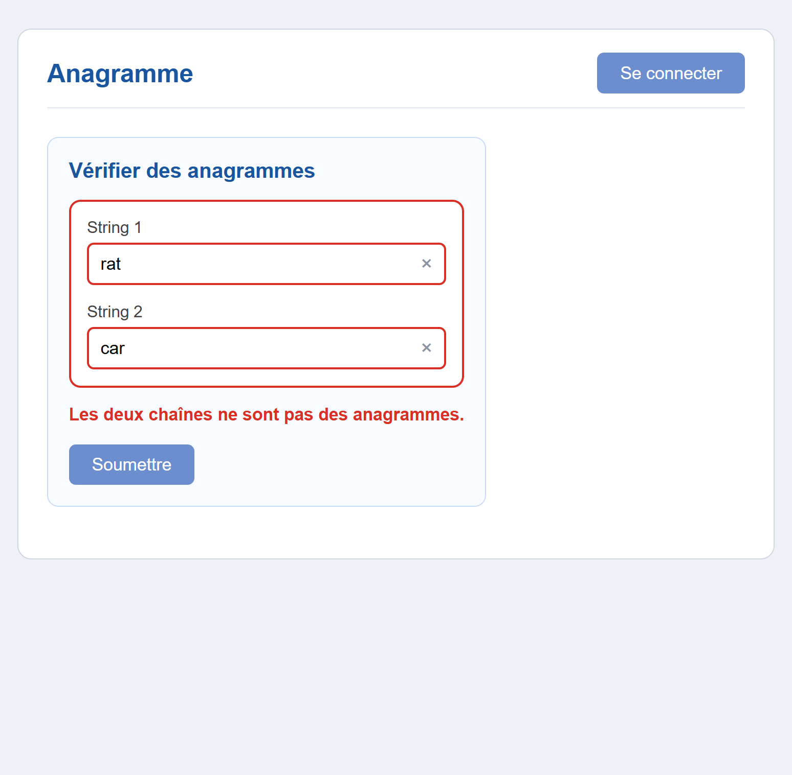
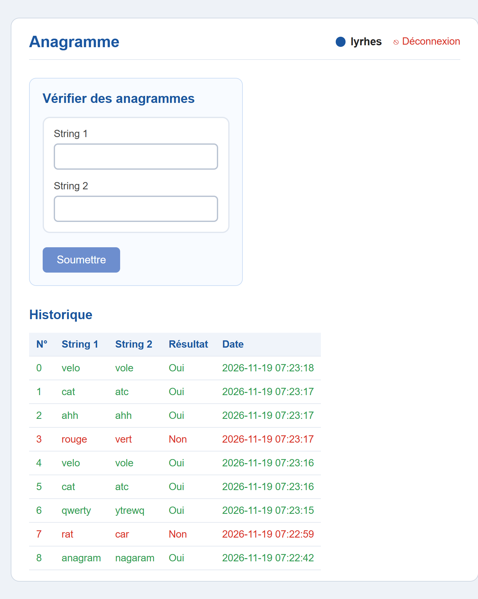
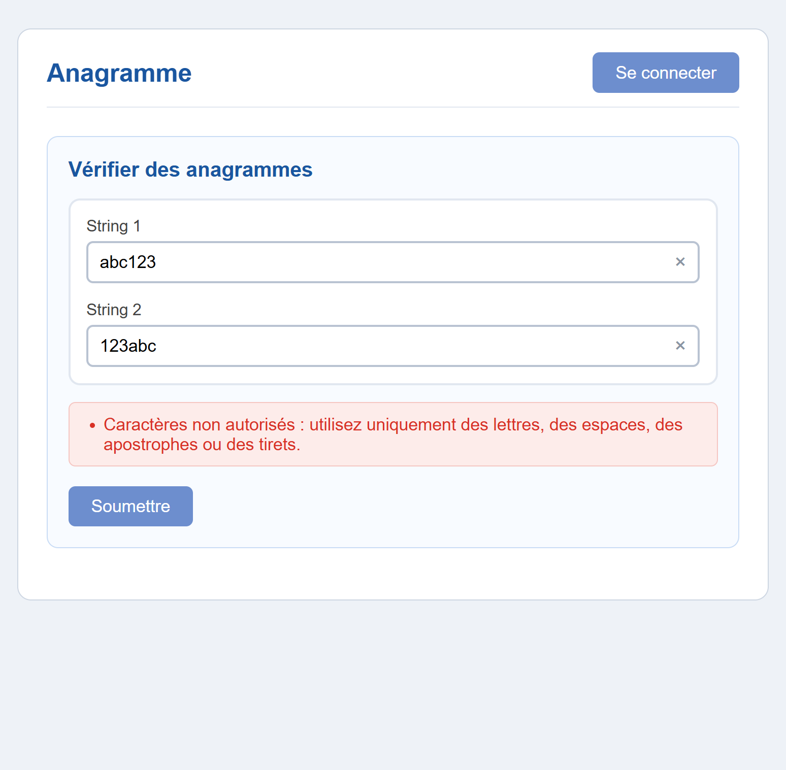
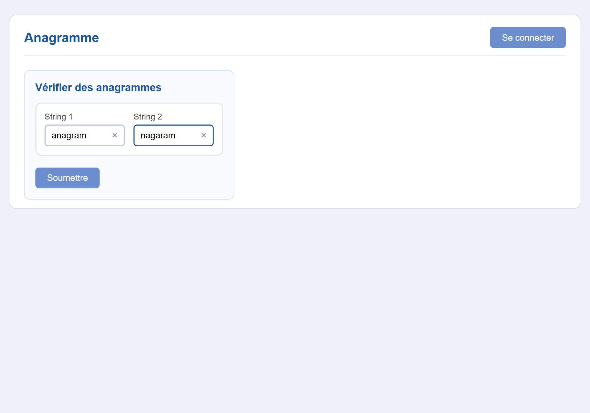

# Anagramme — TP PHP / MySQL (WAMP)

Application web simple permettant de vérifier si deux chaînes de caractères sont des
anagrammes, avec inscription, connexion et historique personnel des vérifications.

Aucun JavaScript n'est utilisé : uniquement HTML5, CSS3, PHP 8 et MySQL (PDO).

## Fonctionnalités

- Vérification de deux chaînes (sans tenir compte de la casse ni des espaces).
- Champs et cadre du formulaire en vert si les chaînes sont des anagrammes, en rouge sinon.
- Icône « × » dans chaque champ pour le vider d'un clic (sans JavaScript).
- Validation : champs vides, caractères non autorisés.
- Inscription (pseudo, mot de passe, confirmation), pseudo unique.
- Connexion / déconnexion avec sessions PHP.
- Historique personnel : chaque utilisateur ne voit que ses propres vérifications.
- Mots de passe stockés de façon sécurisée avec `password_hash()`.

## Arborescence

```
tp/
├── config.php          Connexion PDO + fonctions communes (session, échappement)
├── functions.php       Normalisation des chaînes et algorithme d'anagramme
├── header.php          En-tête commun (nom de l'application, navigation)
├── footer.php          Pied de page commun
├── index.php           Formulaire de vérification + historique
├── register.php        Formulaire d'inscription
├── login.php           Formulaire de connexion
├── logout.php          Déconnexion (fin de session)
├── style.css           Feuille de style
├── sql/
│   └── anagramme.sql   Script de création de la base et des tables
├── captures/           Captures d'écran
└── README.md
```

## Prérequis

- WAMP Server démarré (Apache + MariaDB + PHP 8.x).
- L'extension `pdo_mysql` activée (elle l'est par défaut sous WAMP).

## Installation

### 1. Placer le projet

Copier le dossier `tp` dans le répertoire web de WAMP :

```
C:\wamp64\www\tp
```

### 2. Créer la base de données

**Option A — phpMyAdmin**

1. Ouvrir <http://localhost/phpmyadmin>.
2. Onglet « Importer ».
3. Choisir le fichier `sql/anagramme.sql` puis cliquer sur « Exécuter ».

**Option B — ligne de commande**

```bat
C:\wamp64\bin\mariadb\mariadb11.5.2\bin\mysql.exe -u root -P 3307 < C:\wamp64\www\tp\sql\anagramme.sql
```

Le script crée la base `anagramme` et les tables `users` et `verifications`.

### 3. Vérifier la connexion

Ouvrir `config.php` et adapter si besoin :

```php
define('DB_HOST', '127.0.0.1');
define('DB_PORT', '3307');   // 3306 si votre MariaDB WAMP utilise le port par défaut
define('DB_NAME', 'anagramme');
define('DB_USER', 'root');
define('DB_PASS', '');       // mot de passe root défini lors de l'installation de WAMP
```

> Sur ce poste, MariaDB de WAMP écoute sur le port **3307** (XAMPP occupe le 3306).

### 4. Lancer l'application

Ouvrir : <http://localhost/tp/>

Un compte de démonstration existe déjà dans la base de ce poste : **lyrhes / 1234**
(sinon, créez un compte via « Se connecter » → « S'inscrire »).

## Base de données

### Table `users`

| Colonne      | Type         | Description                          |
|--------------|--------------|--------------------------------------|
| `id`         | INT (PK)     | Identifiant de l'utilisateur         |
| `pseudo`     | VARCHAR(30)  | Pseudonyme unique                    |
| `password`   | VARCHAR(255) | Mot de passe hashé (`password_hash`) |
| `created_at` | TIMESTAMP    | Date de création du compte           |

### Table `verifications`

| Colonne      | Type         | Description                              |
|--------------|--------------|------------------------------------------|
| `id`         | INT (PK)     | Identifiant de la vérification           |
| `user_id`    | INT (FK)     | Utilisateur propriétaire (NULL possible) |
| `string1`    | VARCHAR(255) | Première chaîne                          |
| `string2`    | VARCHAR(255) | Deuxième chaîne                          |
| `is_anagram` | TINYINT(1)   | 1 = anagrammes, 0 = non                  |
| `created_at` | TIMESTAMP    | Date et heure de la vérification         |

La clé étrangère utilise `ON DELETE CASCADE` : si un compte est supprimé, son
historique l'est aussi. La déconnexion, elle, ne supprime pas le compte.

## Algorithme de vérification

1. Normalisation : suppression des espaces, passage en minuscules.
2. Découpage des chaînes en caractères (`mb_str_split`) et comptage des
   occurrences avec `array_count_values()` (clé = caractère, valeur = nombre).
3. Parcours du compteur de la première chaîne : chaque lettre doit avoir
   exactement le même nombre d'occurrences dans la seconde. Si la lettre est
   absente de la seconde chaîne, `($compteurB[$lettre] ?? 0)` vaut `0`.
4. Au moindre écart, la fonction renvoie `false` ; sinon, ce sont des anagrammes.

**Complexité** : `O(n)` en temps (chaque caractère est lu au plus deux fois) et
`O(k)` en espace, où `n` est la longueur des chaînes et `k` le nombre de caractères
distincts (au plus 26 pour l'alphabet latin).

La variante « trier les deux chaînes puis les comparer » serait en `O(n log n)`
à cause du tri : elle est plus simple à expliquer, mais moins efficace.

## Captures d'écran

### Page d'accueil (non connecté)


### Inscription


### Connexion


### Résultat positif


### Résultat négatif


### Historique personnel


### Gestion des erreurs


### Icône d'effacement des champs


## Remarques

- Les requêtes SQL utilisent des requêtes préparées PDO (protection contre l'injection SQL).
- Les valeurs affichées sont échappées avec `htmlspecialchars()` (protection XSS).
- Le formulaire accepte les lettres (accents compris), les espaces, les apostrophes
  et les tirets ; les chiffres et la ponctuation sont refusés.
- L'icône « × » est un bouton de soumission nommé `vider` : PHP vide le champ concerné
  sans lancer la vérification. Aucun JavaScript n'est nécessaire.
